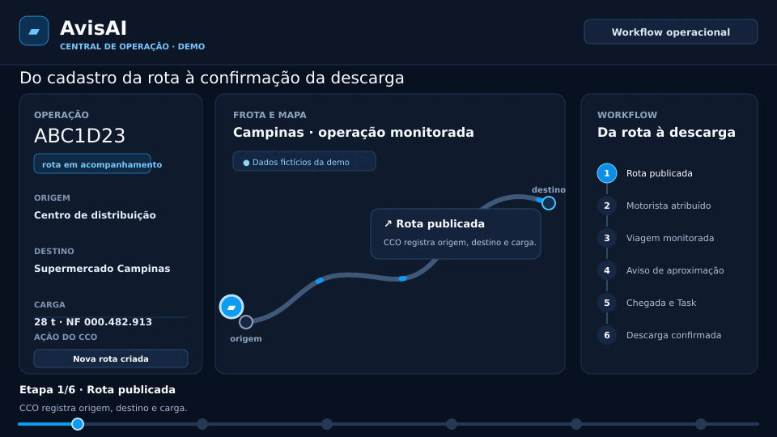
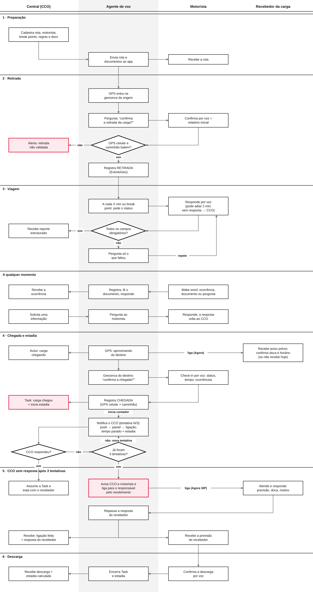

# AvisAI Web · CCO

Painel da central de operação do AvisAI: frota, Tasks, ligações, indicadores, publicação de rotas e anexos. **Modo API** usa operação, métricas/ranking e arquivos do backend AvisAI; **modo Demo** executa a simulação no navegador. Login e documentos fiscais permanecem declarados como MOCK. O mapa base usa Google Maps JavaScript API quando uma chave é configurada.



O fluxo mostra uma operação fictícia da Demo: o CCO publica e atribui a rota, acompanha a viagem, recebe o aviso de aproximação, trata a Task de chegada e confirma a descarga. Os estados exibidos não comprovam GPS, telefonia ou autenticação reais.

## Como os papéis se conectam



| Papel | Onde | O que faz |
|---|---|---|
| 🖥️ **Central (CCO)** | Este painel | Cadastra rota, motorista, regras e documentos; recebe reportes, ocorrências e a Task de chegada com tempo parado e estadia; assume a Task e confirma a descarga. |
| 🎙️ **Agente de voz** | Backend + Agora | Pede status por voz, valida retirada e chegada pelo GPS do celular e do caminhão, avisa o recebedor na aproximação e liga para ele quando o CCO não responde após 3 tentativas. |
| 🚚 **Motorista** | App mobile | Confirma retirada, chegada e descarga por voz, reporta ocorrências e pergunta sobre os documentos da rota. |
| 🏭 **Recebedor da carga** | Ligação | Recebe o aviso prévio e informa doca, horário e previsão de descarga. |

O aviso na aproximação antecipa a doca; a Task na chegada inicia a contagem da estadia; a ligação ao recebedor fecha o ciclo quando o CCO não responde. Nesta Demo, voz, GPS e ligações são simulados (ver [O que é simulado](#o-que-é-simulado)). Problemas e decisões por trás do fluxo: [REGRAS-DE-NEGOCIO.md](docs/REGRAS-DE-NEGOCIO.md).

## Como rodar

Use Node.js **22.22.3 ou superior** e npm.

```bash
npm install
npm run dev
```

Abra a URL indicada pelo Vite, normalmente `http://localhost:5173`. O login da Demo usa uma sessão local após 600 ms; no modo API, lista os perfis CCO cadastrados em `/usuarios?role=cco` e chama `/auth/sso` com o e-mail escolhido. Ambos são MOCK, sem autenticação real.

```bash
npm test
npm run typecheck
npm run build
npm run preview
```

O servidor do Vite serve os arquivos locais durante o desenvolvimento. Sem chave Google, o mapa informa a limitação e mantém a visão local, a lista da frota e a seleção de viagens.

## Conectar ao backend AvisAI

Configure a `.env` local e reinicie o Vite:

```dotenv
VITE_API_BASE_URL=http://127.0.0.1:8000
```

Uma URL preenchida seleciona **API**: o painel lê a operação, acompanha SSE e consulta Tasks, chamadas, eventos, rotas, métricas e recebedores. **Assumir** confirma a Task; **Confirmar descarga** encerra a estadia no servidor. GPS, estados e valores financeiros são apresentados como recebidos, sem usar a fórmula ou o relógio da demo.

A variável vazia seleciona **Demo**. Se a API falhar, o painel mostra carregamento/erro e **Tentar novamente**; a troca para **Usar demo** exige uma ação explícita. Durante uma reconexão, os dados operacionais ficam identificados como desatualizados.

KPIs e ranking vêm de `/api/metrics` e `/api/receivers`, com populações e unidades do backend. Sem amostras, valores nulos aparecem como `—`. Não há série temporal ou estadia cobrada nessa API; o painel informa a ausência e não usa o histórico fictício para preenchê-las.

`/auth/sso` devolve token fake; `/api/documents` entrega NF-e/CT-e com `mock:true`, `fileUri:null`. Esses documentos são separados dos anexos reais. O histórico de 63 entregas pertence somente à Demo. O backend atual permite CORS amplo e não verifica autorização de usuários, viagens ou arquivos; autenticação/autorização são pendências antes de produção.

O seed do backend tem uma rota de 28 t com trajeto linear; o painel mostra esse caminho como fornecido pela API. Não cria oito caminhões, estrada, GPS ou telefonia para completar os dados. O painel não inicia ligações, reseta rotas ou envia posições.

Consulte a [matriz de integração](docs/INTEGRACAO-BACKEND.md) para endpoints, limites, recursos pendentes e validação. Com banco/API locais, as cinco leituras REST retornaram HTTP 200 e o SSE publicou `snapshot` e `contador`. O navegador mostrou a rota de Carlos, 28 t, NF `000.482.913`, ausência de GPS, Google Maps com o trajeto linear de 41 pontos, pt-BR/en e recursos MOCK identificados. Eventos de voz chegaram ao vivo; o painel não os iniciou.

**Assumir** e **Confirmar descarga** foram verificados com transportes controlados nos testes. Nenhum desses POSTs foi executado no backend ativo, que não tinha Tasks ou estadias para essas ações. O backend foi iniciado sem túnel público.

## Rotas, motoristas e arquivos

No modo API, a tela `/dispatch` permite cadastrar motoristas, publicar rota com ou sem motorista e atribuí-la posteriormente. O backend publica eventos de atribuição que o mobile pode acompanhar. POSTs não são repetidos automaticamente.

O CCO pode anexar **arquivos reais** à rota e baixá-los depois. São aceitos PDF/JPEG/PNG/WebP/GIF, até 10 MiB por padrão; o limite é configurável no backend. O dossiê também consulta pedidos/respostas da central e metadados fiscais MOCK, preservando sua origem.

Esta entrega modifica também `/home/henry/Documents/avisai/backend`, fora do repositório web. Metadados dos anexos ficam no banco e os binários em `ARQUIVOS_DIR`; o Compose monta `./backend/data/arquivos:/app/data/arquivos`. A migration e esse volume precisam acompanhar o backend; backup inclui banco e arquivos. Reset operacional preserva anexos.

Para implementar o consumo pelo app do motorista, use o [modelo mobile](docs/CONTRATO-MOBILE.md) e o [exemplo TypeScript independente](docs/examples/mobile-client.ts). São referências de integração, não um app mobile entregue.

## Popular o banco e escolher usuários

No repositório do backend (`../avisai`), com os serviços `db` e `api` iniciados:

```bash
docker compose exec -T api alembic upgrade head
docker compose exec -T api python -m app.seed
```

A população complementa os dados existentes: cria dois operadores CCO e quatro motoristas de demonstração, com viagens diferentes e um motorista sem viagem. Reexecutar o comando mantém os mesmos registros e preserva atribuições, status e arquivos existentes. Não use `--reset` para complementar uma base em uso.

`GET /usuarios` (alias `/api/users`) retorna os perfis persistidos. Use `?role=driver` no celular e `?role=cco` no painel. A seleção envia o e-mail cadastrado para `POST /auth/sso`; um e-mail desconhecido recebe 404. O [contrato mobile](docs/CONTRATO-MOBILE.md) descreve os campos e a troca de usuário com encerramento das conexões anteriores.

## Configurar Google Maps

Preencha `VITE_GOOGLE_MAPS_API_KEY` no arquivo `.env` local. Se precisar recriar o arquivo, copie `.env.example` para `.env`. Reinicie o Vite após alterar as variáveis.

```dotenv
VITE_GOOGLE_MAPS_API_KEY=
VITE_GOOGLE_MAPS_MAP_ID=DEMO_MAP_ID
```

`VITE_GOOGLE_MAPS_MAP_ID` é opcional; sem valor, o app usa `DEMO_MAP_ID`.

No projeto do Google Cloud, habilite **Maps JavaScript API** e configure a cobrança exigida pelo Google Maps Platform. Restrinja a chave por **HTTP referrers** aos endereços permitidos de desenvolvimento e produção, e por API a **Maps JavaScript API**. Routes API não é necessária para esta demo. O app não habilita APIs nem altera a conta ou cobrança.

Variáveis `VITE_` entram no bundle do navegador: essa chave é pública para o cliente e depende dessas restrições. `.env` é ignorado pelo Git; não registre seu valor na documentação, em logs ou no repositório.

O SDK faz requisições ao Google para o mapa base. Fontes e traduções continuam locais; não há solicitação de rota ao Google ou OSRM durante a execução. A Demo usa snapshots rodoviários locais; o modo API usa o trajeto entregue pelo backend. O mapa carrega o SDK diretamente, sem acrescentar uma biblioteca de integração.

Referências: [carregar Maps JavaScript API](https://developers.google.com/maps/documentation/javascript/load-maps-js-api), [restrições de chaves](https://developers.google.com/maps/api-security-best-practices), [OSRM](https://project-osrm.org/) e [atribuição OpenStreetMap](https://www.openstreetmap.org/copyright).

## Dependências

React, Vite, TypeScript strict, Tailwind CSS v4 com `@tailwindcss/vite`, React Router, zustand, Recharts e i18next/react-i18next. As versões instaladas estão no `package-lock.json`. Os testes usam `node:test`, sem biblioteca de testes adicional.

## O que é simulado

No modo API, operação, KPIs/ranking e anexos vêm do backend. SSO, notas fiscais e complementos comerciais continuam identificados como MOCK; campos comerciais recebidos da rota são preservados. Os itens abaixo descrevem a **Demo local**:

- **SSO:** atraso local de 600 ms e usuário fictício; não autentica em provedor externo.
- **Frota:** oito caminhões, cinco recebedores e seus dados operacionais são fictícios na região de Campinas/SP. O progresso e a posição do caminhão seguem o caminho local da demo; não existe GPS real.
- **Caminhos:** cinco snapshots OSRM/OpenStreetMap versionados no projeto representam os trajetos rodoviários. A demonstração não consulta tráfego nem recalcula caminhos em serviços externos.
- **Dossiê da viagem:** carga, notas fiscais e mensagens ilustrativas são dados comerciais fictícios; não há documento fiscal válido, leitura de documentos ou canal de comunicação real.
- **Tempo:** cada segundo real avança um minuto da operação, a partir de 08:00. Pausar interrompe o avanço.
- **Eventos e Tasks:** aproximação, chegada, avisos, resposta do operador, escalada, ocorrência e descarga são gerados localmente.
- **Ligações:** resultado e transcrição são texto simulado. Não há áudio, SIP ou chamada telefônica.
- **Histórico:** 63 entregas fictícias, nove por dia durante sete dias, geradas com mulberry32 e seed 42.
- **Indicadores:** calculados sobre esse histórico e as entregas concluídas na sessão; não representam desempenho real.
- **Cobrança:** marca fictícia de cobrança em aproximadamente 15% das entregas com estadia positiva.

O estado da Demo fica em memória. Recarregar inicia outra sessão de demonstração. No modo API, o painel recarrega o estado mantido pelo backend; não possui persistência operacional própria. Após editar o módulo do motor durante o desenvolvimento, recarregue a página para iniciar o relógio com a nova instância do store.

## Mapa e monitoramento

- **Mapa base real:** Google Maps JavaScript API apresenta a região e os marcadores; não fornece posição, tempo ou estado operacional dos caminhões.
- **Caminhos da Demo:** o motor e o mapa usam a mesma geometria local por recebedor. A distância é medida ao longo dos segmentos e `trip.progress` posiciona o caminhão nesse caminho, mantendo 70 km/h e o relógio simulado.
- **Caminhos e posições da API:** a geometria e o último GPS são os informados pelo backend. Sem posição, o painel informa a ausência; não gera GPS ou movimento pelo relógio da Demo nem troca o trajeto por uma estrada local.
- **Sem recálculo por tick:** os snapshots da Demo são preparados em memória; no modo API, o detalhe da rota fornece o caminho. Navegar, selecionar caminhões e receber atualizações não solicita rotas ao Google ou OSRM.
- **Atribuição:** geometrias obtidas com OSRM em 22/11/2026, sobre dados © OpenStreetMap contributors. Cada fixture registra origem da consulta e ajustes dos extremos à via.

O Dashboard prioriza o mapa em largura: lista da frota à esquerda, mapa no centro e dossiê da viagem selecionada à direita. Busca, filtros e seleção sincronizam lista e marcadores; detalhes de carga, notas e comunicações permanecem visíveis sem sair do monitoramento. Avisos/eventos e o resumo completo de dez KPIs ficam abaixo.

Na Demo, o caminho selecionado separa o trecho percorrido contínuo e o restante tracejado. Os caminhões avançam suavemente pelos segmentos, com orientação conforme a via; **Seguir caminhão** acompanha a posição. Pausar congela o progresso. Esses controles não aceleram nem pausam o backend.

Sem chave ou diante de falha do SDK, o painel informa a limitação em pt-BR ou inglês e apresenta as geometrias disponíveis em uma visão local, com seleção de caminhões. A fonte operacional selecionada continua funcionando.

## Decisões da demonstração

Estas regras pertencem à Demo; no modo API, o servidor governa tentativas, tempo, estados e estadia.

- Aviso efetivo exige ligação atendida antes da chegada; tentativa sem atendimento permanece no log.
- A Task recebe avisos em T+0, T+20 e T+40 min. Sem resposta, fica escalada em T+60 min. A chance inicial de resposta mock é 35% por tentativa; o controle permite alterá-la.
- “Assumir” funciona para Tasks abertas ou escaladas. Descarga fecha a Task e encerra o contador.
- A resposta “só amanhã às 7h” é informativa nesta versão; não agenda a descarga. A espera segue o perfil fictício do recebedor.
- Placa e motorista permanecem associados ao mesmo caminhão; cada ciclo cria uma nova viagem, 30 min após a descarga.
- O histórico usa contagens de avisos efetivos `4, 5, 6, 6, 7, 8, 8` por dia: cerca de 44% a 89%. Com nove entregas, a resolução é 11,1 pontos percentuais; os alvos de 45% a 93% do briefing não são percentuais exatos observáveis.
- A composição do histórico é controlada para mostrar aumento dos avisos e queda da espera. Isso é um roteiro sintético, não prova de causalidade.
- O simulador usa sequências aleatórias independentes por caminhão e domínio, com sementes derivadas da base 42 e separadas do histórico, para tornar a demonstração reproduzível.
- A estadia segue exclusivamente a fórmula definida para a demo; o aviso prévio não acrescenta outra condição ao cálculo.

## Componentes preexistentes

Nenhuma fonte anterior ao hackathon. O repositório já continha uma base do painel criada durante o hackathon; esta entrega completa e corrige essa base. As bibliotecas utilizadas estão listadas acima.

## Documentação e ajustes futuros

- [Arquitetura, fórmulas e roteiro de dois minutos](docs/ARQUITETURA.md)
- [Integração com o backend: APIs, MOCK e pendências](docs/INTEGRACAO-BACKEND.md)
- [Modelo mobile: identidade, rota atribuída e anexos](docs/CONTRATO-MOBILE.md)
- [Regras da simulação](docs/REGRAS-DE-NEGOCIO.md)
- [Design e acessibilidade](docs/DESIGN.md)
- [Fluxograma completo do produto](docs/ARQUITETURA.md#fluxo-completo-do-produto) e [problemas resolvidos pelo time](docs/REGRAS-DE-NEGOCIO.md), vindos do repositório de ideias `chapahalls-ideas`

A skill de manutenção `avisai-web-maintenance` reúne o contexto necessário para ajustar domínio, telas e traduções preservando os limites entre a operação simulada e as integrações autorizadas. Ela acompanha o repositório em `.agents/skills/avisai-web-maintenance`.

## Versão entregue

**v0.1.0**
