<p align="center">
  
</p>

<h1 align="center">RODAR</h1>

<p align="center">
  <a href="https://github.com/rodarglobal/rodar-web/actions/workflows/ci.yml"></a>
</p>

<p align="center">
  <strong>O agente de voz que conecta motorista, recebedor e central de operação (CCO).</strong><br />
  Este repositório é o <strong>site público</strong> e o <strong>painel web do CCO</strong>.
</p>

<p align="center">
  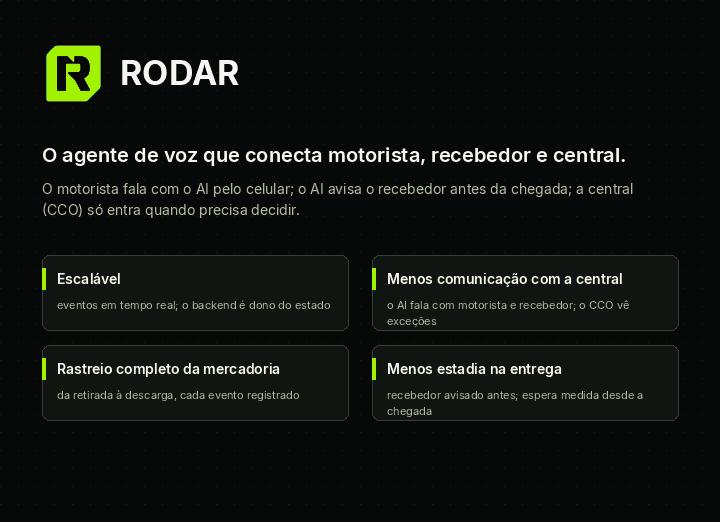
</p>

<p align="center">
  <sub>Gravado em modo Demo, com dados fictícios. Voz, GPS e telefonia são simulados nesta gravação.</sub><br />
  <sub>▶️ <a href="docs/assets/readme/tour.mp4">Ver em vídeo (MP4, 1280 px, 1 min 9 s)</a></sub>
</p>

## Para o júri

| | |
|---|---|
| **Trilha** | Logística & automação |
| **Em uma frase** | Um agente de voz que avisa o recebedor antes da chegada, conta a estadia do caminhão parado (Lei 11.442) e só chama a central quando alguém precisa decidir. |
| **Ver sem instalar nada** | [tour em vídeo de 1 min](https://github.com/rodarglobal/rodar-web/blob/main/docs/assets/readme/tour.mp4) do site e do painel · [tour do app do motorista (1 min)](https://github.com/rodarglobal/rodar-mobile/blob/main/docs/assets/readme/tour.mp4) · [validação ponta a ponta com a api real: 33 de 33 etapas](https://github.com/rodarglobal/rodar-backend/blob/main/evidence/validacao.md) · [telas do app](https://github.com/rodarglobal/rodar-mobile#telas-do-aplicativo) |
| **Repositórios** | [rodar-backend](https://github.com/rodarglobal/rodar-backend) · [rodar-web](https://github.com/rodarglobal/rodar-web) (este) · [rodar-mobile](https://github.com/rodarglobal/rodar-mobile) |
| **Qualidade** | CI em cada repositório com lint e testes (e typecheck nos fronts) · 524 testes automatizados: 299 no backend, 127 no web, 98 no mobile |
| **Segurança** | JWT assinado no login, papel `cco` nas ações da central, CORS restrito, segredo do LLM e limite de ligações ([detalhes](https://github.com/rodarglobal/rodar-backend#segurança)) |
| **O que é simulado** | login sem senha, GPS da rota, documentos fiscais e o modo Demo do painel: [lista completa](#o-que-é-simulado) |
<!-- Demo publicada e vídeo de 3 min do Hack Brasil: incluir as duas linhas aqui antes de 30/11. -->

## Para que serve

O motorista fala com o AI pelo celular, sem digitar. O AI avisa o recebedor antes da chegada, acompanha a espera na doca e só chama a central quando alguém precisa decidir.

| | Pilar | Como o RODAR entrega |
|---|---|---|
| 📈 | **Escalável** | Toda mudança vira evento: viagem, aproximação, ligação, Task, descarga. O backend é dono do estado e transmite ao vivo (SSE). O painel e o app só leem e reagem. Uma rota ou a frota inteira usam o mesmo fluxo, sem ninguém ao telefone por caminhão. |
| 🔇 | **Menos comunicação com a central** | O AI pede status ao motorista por voz, liga para o recebedor e registra as respostas. O CCO recebe só exceções, numa fila ordenada por severidade: recebedor que não atende, ocorrência, espera acima da franquia. |
| 📍 | **Rastreio completo da mercadoria** | Da retirada à descarga, cada viagem guarda posição, paradas, ocorrências, ligações transcritas, mensagens, documentos e decisões do agente, numa linha do tempo filtrável. |
| ⏱️ | **Menos estadia na entrega** | Na Demo, o aviso simulado ocorre a 8 km do destino. No modo API, o backend usa o ETA configurado na rota (15 min por padrão) e só liga se a telefonia estiver configurada. Na chegada, o contador de estadia começa (franquia de 5 h, Lei 11.442) e as Análises mostram espera média, avisos antecipados e estadia devida. |

## Como funciona

O fluxograma abaixo mostra uma viagem do início ao fim. No GitHub, use os controles do diagrama para ampliar e arrastar. Em seguida, abra cada etapa para ver a tela correspondente.

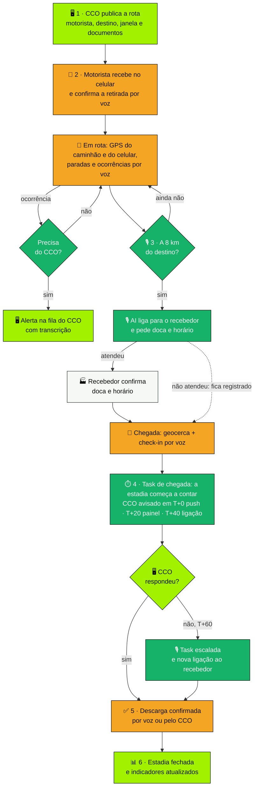

<sub>Cores por papel: 🟩 lima = CCO · 🟢 verde = agente de voz · 🟧 âmbar = motorista e caminhão · ⬜ claro = recebedor.</sub>

<details>
<summary><strong>1 · O CCO publica a rota</strong> (Trip dispatch)</summary>
<br />

Em `/dashboard/dispatch`, o CCO vê os motoristas cadastrados e suas viagens. A rota só pode ser editada antes da saída: publicada, planejada ou na origem. `/dashboard/dispatch/new` cadastra a viagem em 4 etapas: motorista, destino e entrega, regras do agente e documentos. O resumo estima o custo de voz no pior caso.

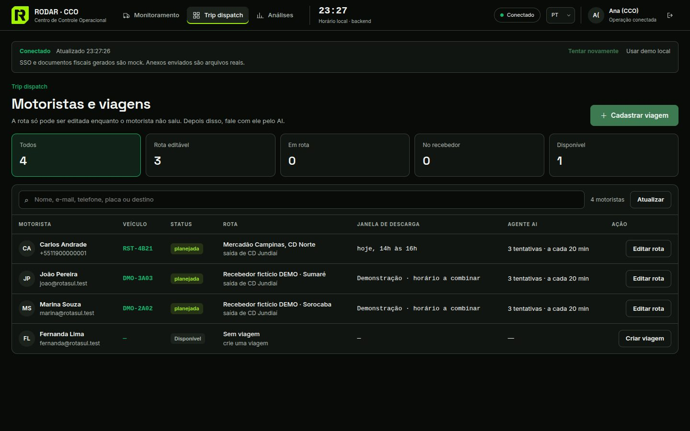
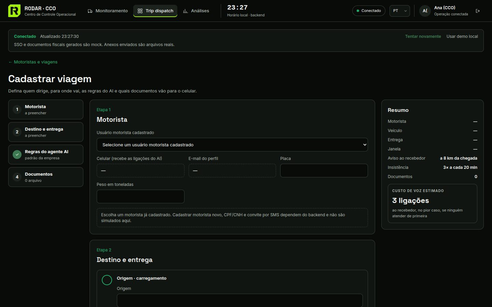

<sub>Capturas em modo API, com os perfis fictícios do seed do backend.</sub>
</details>

<details>
<summary><strong>2 · O motorista fala, não digita</strong> (app e agente de voz)</summary>
<br />

O AI roda no celular do motorista. Retirada, chegada, descarga e ocorrências são confirmadas por voz, e o motorista pode perguntar sobre os documentos da rota. O GPS do caminhão é a prova forte da posição. Com sinal, a voz vai direto ao agente, sem gravação; sem sinal, o app grava cada fala e envia quando a rede volta, e o AvisAI responde depois. O app mobile fica em outro repositório, com as [telas do app](https://github.com/rodarglobal/rodar-mobile#telas-do-aplicativo); o contrato está em [CONTRATO-MOBILE.md](docs/CONTRATO-MOBILE.md).

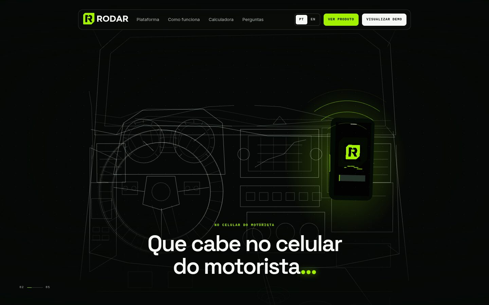

</details>

<details>
<summary><strong>3 · Aviso ao recebedor antes da chegada</strong></summary>
<br />

Na Demo, o aviso simulado é disparado a 8 km do destino. No modo API, a aproximação segue o ETA configurado na rota (15 min por padrão) e a chamada depende da telefonia configurada. O aviso pergunta doca e horário; uma tentativa sem resposta também fica registrada.

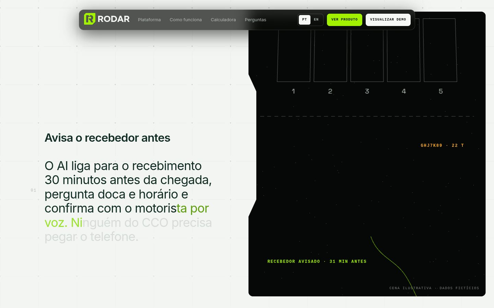
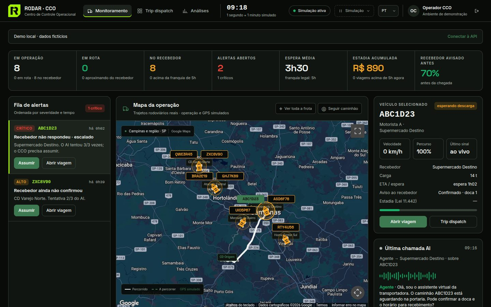
</details>

<details>
<summary><strong>4 · Task de chegada e escalonamento só quando precisa</strong></summary>
<br />

A chegada cria a Task e inicia a espera. O CCO é avisado em canais cada vez mais fortes: push em T+0, destaque no painel em T+20 e ligação em T+40. Sem resposta, em T+60 a Task é escalada e o AI liga de novo para o recebedor. **Assumir** encerra as novas tentativas. No monitoramento (`/dashboard`), a fila de alertas é ordenada por severidade e tempo.


</details>

<details>
<summary><strong>5 · Rastreio completo da viagem</strong></summary>
<br />

Em `/dashboard/trips/:id` ficam o motorista e os últimos 7 dias dele, onde ele parou e uma linha do tempo filtrável (paradas, agente, CCO, recebedor) com a transcrição das ligações. A tela também traz a mensagem por voz ao motorista (API), o mapa da rota e o dossiê com documentos.

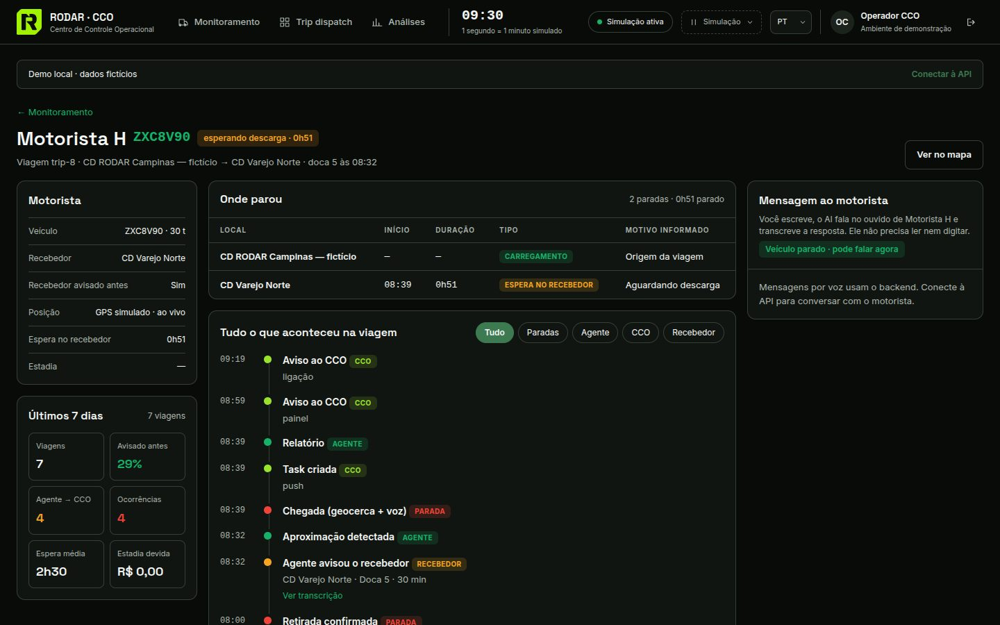
</details>

<details>
<summary><strong>6 · Estadia fechada e análises</strong></summary>
<br />

A descarga, confirmada por voz ou pelo CCO, encerra o contador. Em `/dashboard/metrics`, as análises cruzam período, recebedor, motorista e tipo de ocorrência. Mostram o funil dos avisos, ligações do agente × escaladas ao CCO por dia, espera média, estadia devida e contatos evitados, com exportação em CSV.

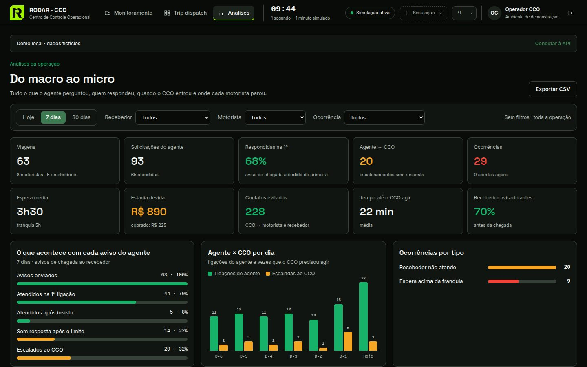
</details>

## Telas

<table>
  <tr>
    <td width="33%"><br /><sub><b>Home</b> · <code>/home</code>: história 3D guiada pela rolagem</sub></td>
    <td width="33%">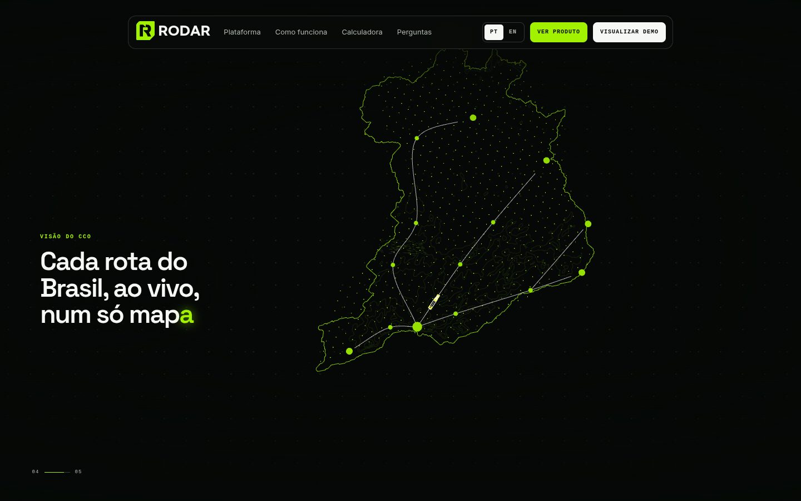<br /><sub>Cada rota do Brasil num só mapa</sub></td>
    <td width="33%">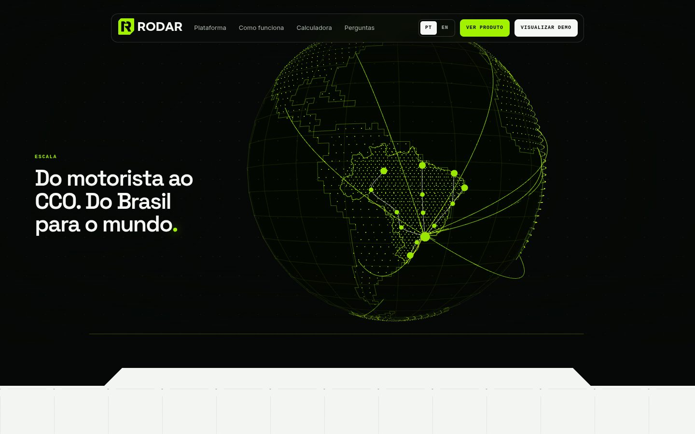<br /><sub>Do motorista ao CCO, do Brasil para o mundo</sub></td>
  </tr>
  <tr>
    <td><br /><sub>Calculadora de estadia (MOCK, não envia dados)</sub></td>
    <td>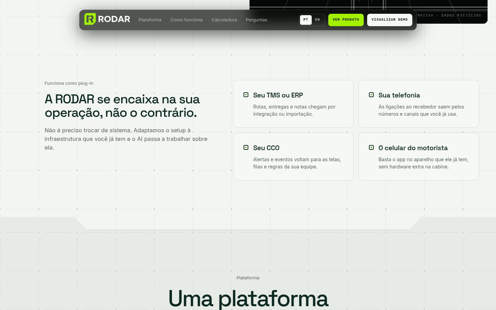<br /><sub>Encaixa no TMS/ERP, na telefonia e no CCO do cliente</sub></td>
    <td>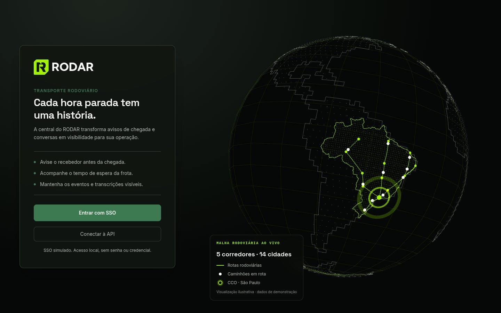<br /><sub><b>Login</b> · <code>/login</code>: SSO simulado</sub></td>
  </tr>
  <tr>
    <td><br /><sub><b>Monitoramento</b> · <code>/dashboard</code></sub></td>
    <td><br /><sub><b>Trip dispatch</b> · <code>/dashboard/dispatch</code></sub></td>
    <td><br /><sub><b>Cadastrar viagem</b> · <code>/dashboard/dispatch/new</code></sub></td>
  </tr>
  <tr>
    <td><br /><sub><b>Motorista e viagem</b> · <code>/dashboard/trips/:id</code></sub></td>
    <td><br /><sub><b>Análises</b> · <code>/dashboard/metrics</code></sub></td>
    <td valign="top"><sub><b>Operador</b> · <code>/dashboard/operator</code>: atende o fallback de chamada do agente via Agora RTC.<br /><br /><code>/</code> e os endereços antigos (<code>/metrics</code>, <code>/trips/:id</code>…) redirecionam para o equivalente em <code>/dashboard</code>. <code>/dashboard/receivers</code> e <code>/dashboard/calls</code> abrem as abas das Análises.</sub></td>
  </tr>
</table>

`/mobile-web` abre uma demonstração pública e interativa do app do motorista, sem login do CCO. O roteiro inclui viagem, aproximação e aviso ao recebedor, check-in, Tasks, recados, documentos, fila e comandos de voz simulados. Nada é enviado à API; o áudio opcional usa a síntese de voz disponível no navegador.

## Como escala

- **Eventos, não telefonemas.** Cada transição é um evento com contrato único (`src/types/events.ts`), o mesmo do app mobile. A central acompanha a frota pelos eventos no painel em vez de ligar para cada motorista.
- **O backend é dono do estado.** No modo API, estadia, capacidade, tarifa e contadores vêm do servidor. O painel recebe um snapshot e depois acompanha o SSE, sem recalcular valores financeiros. Em uma reconexão, os dados ficam marcados como desatualizados.
- **Exceção em vez de rotina.** O agente faz as ligações repetitivas e escala só o que precisa de decisão. A carga do CCO cresce com as exceções, não com o número de caminhões.
- **Plug-in na operação do cliente.** O setup se adapta à infraestrutura existente: TMS ou ERP, telefonia, CCO e o celular do motorista.
- **Front-end por domínio.** Cada área (`monitoring`, `dispatch`, `trips`, `analytics`…) é uma feature isolada que só expõe o `index.ts`. Novas telas entram sem mexer nas outras.

## Rodar localmente

Use Node.js **22.22.3 ou superior** e npm.

```bash
npm install
npm run dev
```

Abra a URL indicada pelo Vite, normalmente `http://localhost:5173`. Sem `VITE_API_BASE_URL`, o painel roda a **Demo** no navegador. Basta clicar em **Entrar com SSO**.

```bash
npm test
```

```bash
npm run typecheck
```

```bash
npm run lint
```

```bash
npm run build
```

| `VITE_API_BASE_URL` | Origem | O que o painel usa | O que ele não inventa |
|---|---|---|---|
| vazia | **Demo** | frota, relógio, eventos, rotas rodoviárias versionadas, histórico e indicadores locais | GPS, documentos fiscais, login, ligação ou comunicação reais |
| preenchida, ex.: `http://127.0.0.1:8000` | **API** | rotas, GPS, Tasks, estadias, chamadas, alertas, mensagens, arquivos, métricas e ranking do backend | posição ausente, estrada, valores financeiros, histórico ou resultado de telefonia |

Se a API falhar, o painel mostra o erro e **Tentar novamente**. A troca para **Usar demo** é sempre uma ação explícita: não há fallback automático nem repetição automática de POST.

<details>
<summary><strong>Conectar ao backend RODAR</strong></summary>
<br />

Configure a `.env` local e reinicie o Vite:

```dotenv
VITE_API_BASE_URL=http://127.0.0.1:8000
```

O painel lê a operação, acompanha o SSE e consulta Tasks, chamadas, eventos, rotas, métricas e recebedores. **Assumir** confirma a Task e **Confirmar descarga** encerra a estadia no servidor. GPS, estados e valores financeiros aparecem como foram recebidos, sem a fórmula ou o relógio da Demo.

KPIs e ranking vêm de `/api/metrics` e `/api/receivers`, com populações e unidades do backend. Sem amostras, valores nulos aparecem como `—`. A API não tem série diária nem estadia cobrada: o painel informa a ausência e não usa o histórico fictício para preenchê-las.

`/auth/sso` é um login sem senha que devolve um JWT assinado. Com `AUTH_OBRIGATORIA=true` (padrão do backend), toda escrita exige esse token e as ações da central exigem o papel `cco`; o CORS aceita só as origens configuradas. `/api/documents` entrega NF-e/CT-e com `mock:true` e `fileUri:null`, separados dos anexos reais. Login de verdade, 2FA e leituras protegidas ainda faltam: veja o [README do backend](https://github.com/rodarglobal/rodar-backend#o-que-falta-para-produção).

**Rotas, motoristas e arquivos.** `/dashboard/dispatch` consulta só perfis de motorista já cadastrados. O CCO publica a rota para um deles ou troca o motorista enquanto a viagem não saiu; não há cadastro de motorista nessas telas. O CCO pode anexar arquivos reais (PDF/JPEG/PNG/WebP/GIF, até 10 MiB por padrão) e baixá-los depois. Os metadados ficam no banco e os binários no volume `ARQUIVOS_DIR` do backend; o backup precisa incluir os dois.

**Popular o banco.** No repositório do backend (`../rodar-backend`), com `db` e `api` iniciados:

```bash
docker compose exec -T api alembic upgrade head
```

```bash
docker compose exec -T api python -m app.seed
```

O seed cria dois operadores CCO e quatro motoristas de demonstração, e reexecutá-lo preserva os registros existentes. `GET /usuarios?role=cco` lista os perfis do login; `?role=driver`, os do celular.

**Alertas e voz do agente.** Cada fala do motorista gera `alerta_motorista` no stream, com tipo, resumo, transcrição e prioridade. **Enviar mensagem ao motorista** persiste a mensagem e pede que o agente a fale (`enviada`, `falada`, `respondida` ou `offline`). Sem sessão de voz, o backend inicia a cascata `ligar(operador, motivo)`: primeiro Twilio PSTN, depois Agora RTC em `/dashboard/operator`, e escalada crítica após 30 s. As credenciais ficam só no backend, nunca em `VITE_*` nem no repositório.

Mais detalhes: [matriz de integração](docs/INTEGRACAO-BACKEND.md), [modelo mobile](docs/CONTRATO-MOBILE.md) e [exemplo de cliente TypeScript](docs/examples/mobile-client.ts).
</details>

<details>
<summary><strong>Configurar Google Maps</strong></summary>
<br />

Preencha a `.env` local (copie de `.env.example`) e reinicie o Vite:

```dotenv
VITE_GOOGLE_MAPS_API_KEY=
VITE_GOOGLE_MAPS_MAP_ID=DEMO_MAP_ID
```

Habilite **Maps JavaScript API** no Google Cloud e restrinja a chave por **HTTP referrers** e por API. Variáveis `VITE_` entram no bundle: a chave é pública e depende dessas restrições. `.env` é ignorada pelo Git; nunca registre o valor no repositório.

O Google Maps é só o mapa base. A Demo usa snapshots rodoviários OSRM versionados e o modo API usa o trajeto e o GPS do backend. Não há Routes API nem rota recalculada a cada tick. Sem chave, o painel mostra um aviso traduzido e mantém a visão local, a lista da frota e a seleção de viagens.

Referências: [Maps JavaScript API](https://developers.google.com/maps/documentation/javascript/load-maps-js-api), [segurança de chaves](https://developers.google.com/maps/api-security-best-practices), [OSRM](https://project-osrm.org/) e [OpenStreetMap](https://www.openstreetmap.org/copyright).
</details>

## O que é simulado

No modo API, a operação, os KPIs/ranking e os anexos vêm do backend. **SSO, notas fiscais e complementos comerciais continuam MOCK** e aparecem identificados assim. Os itens abaixo valem para a **Demo local**:

- **SSO:** atraso local de 600 ms e usuário fictício, sem provedor externo.
- **Frota:** oito caminhões e cinco recebedores fictícios na região de Campinas/SP. Não existe GPS real.
- **Caminhos:** cinco snapshots OSRM/OpenStreetMap versionados (obtidos em 22/11/2026). Não há consulta de tráfego.
- **Tempo:** cada segundo real avança um minuto da operação, a partir das 08:00. Pausar congela o relógio.
- **Eventos e Tasks:** aproximação, chegada, avisos, resposta do operador, escalada, ocorrência e descarga são gerados localmente.
- **Ligações:** resultado e transcrição são texto simulado, sem áudio, SIP ou chamada telefônica.
- **Histórico:** 63 entregas fictícias (nove por dia em sete dias), com seed 42. Os indicadores não representam desempenho real.
- **Dossiê:** carga, notas fiscais e mensagens são fictícias.
- **Cobrança:** marca fictícia em cerca de 15% das entregas com estadia positiva.
- **Home:** os formulários da calculadora e de contato validam no navegador e não enviam dados.

O estado da Demo fica em memória: recarregar a página inicia outra sessão. Regras completas e parâmetros: [REGRAS-DE-NEGOCIO.md](docs/REGRAS-DE-NEGOCIO.md) e `src/lib/config.ts`. A estadia local é calculada só em `src/utils/stay.ts`:

```text
ceil(max(0, espera_em_min / 60 − 5)) × toneladas × R$ 2,50
```

## Arquitetura do front-end

React, Vite, TypeScript strict, Tailwind CSS v4, React Router, zustand, Recharts, i18next (pt-BR e en), three.js na home e no login, `agora-rtc-sdk-ng` e `lenis`. Os testes usam `node:test`, sem biblioteca adicional.

```text
src/
├── app/                 composição, guarda de sessão e rotas
├── pages/               telas conectadas ao roteador
├── features/            um domínio por pasta; só o index.ts é público
│   ├── home/            site público: cenas 3D, calculadora e contato
│   ├── auth/            sessão SSO MOCK
│   ├── monitoring/      KPIs, fila de alertas, veículo, última chamada, docas
│   ├── fleet/           mapa e seleção da frota
│   ├── dispatch/        motoristas, publicação, edição de rota e arquivos
│   ├── trips/           viagem, linha do tempo, conversa e dossiê
│   ├── tasks/           Tasks e solicitações do motorista
│   ├── analytics/       análises, filtros, funil e exportação CSV
│   ├── metrics/         KPIs da API
│   ├── receivers/       ranking da API
│   └── calls/           histórico de ligações
├── services/
│   ├── api/             contrato validado, REST e SSE
│   ├── operations/      seleção API/Demo e reconciliação do estado
│   ├── analytics/       métricas e ranking da API
│   └── mock/            motor, fixtures, histórico e dossiê da Demo
├── components/          layout e componentes compartilhados
├── lib/                 configuração, rotas, i18n e Google Maps
├── types/               contratos de domínio e eventos
└── utils/               geometria, estadia, formatação e rotas
```

Cada página é carregada sob demanda (`React.lazy` em `src/app/router.tsx`): o painel não baixa o three.js da home e do login, e o pacote inicial cai de 2,3 MB para cerca de 330 kB (104 kB com gzip). No modo API, o JWT do `/auth/sso` vai como `Authorization: Bearer` em todas as chamadas (`ApiClient.setAccessToken`).

As dependências seguem `pages → features → components/services/lib/utils/types`. As cores vêm só dos tokens de `src/index.css` ([DESIGN.md](docs/DESIGN.md)) e todos os textos passam pelo i18n.

## Documentação

- [Arquitetura, reconciliação REST/SSE e roteiro de demo](docs/ARQUITETURA.md)
- [Integração com o backend: APIs, MOCK e pendências](docs/INTEGRACAO-BACKEND.md)
- [Modelo mobile: identidade, rota atribuída e anexos](docs/CONTRATO-MOBILE.md)
- [Regras da simulação e problemas resolvidos pelo time](docs/REGRAS-DE-NEGOCIO.md)
- [Design e acessibilidade](docs/DESIGN.md)
- [Mockups das telas](docs/RODAR-telas/index.html)
- Skill de manutenção: `.agents/skills/rodar-web-maintenance`
- Cenas 3D da home: os `.glb` versionados em `src/features/home/assets` saem dos scripts `npm run generate:*`. Os modelos de origem (`docs/RODAR-telas/landing-page/3d-model/`, cerca de 80 MB e de terceiros) não ficam no git; para regerar os `.glb`, coloque-os nessa pasta.

## Licença e versão

[MIT](LICENSE) · **v0.1.0**

**Histórico:** o projeto começou como *AvisAI* no hackathon UNMUTE by Agora (21–22/11/2026) e continua como **RODAR** no Hack Brasil 2026, na trilha Logística & automação. Os repositórios foram criados em 22/11/2026 e todo o histórico de commits está neles; o AvisAI virou o nome do agente de voz do RODAR.

Repositórios: [rodar-backend](https://github.com/rodarglobal/rodar-backend) · [rodar-mobile](https://github.com/rodarglobal/rodar-mobile) · este (rodar-web).
