# AvisAI Web (CCO) — Arquitetura

React + Vite + TypeScript + Tailwind v4 + React Router + zustand + Recharts + i18next. **Tudo mock**: um motor de simulação no navegador gera a frota, os eventos do agente e as ações da central. Plano geral: `docs/arquitetura-avisai.md` no repositório de ideias.

## Estrutura (feature/domínio)

```
src/
├── app/              # App.tsx (liga o motor), router.tsx (rotas + guarda de sessão)
├── assets/locales/   # pt-BR.json, en.json
├── components/       # UI genérica: Layout (menu, relógio, idioma, controles da demo), Badge
├── features/
│   ├── auth/         # SSO genérico mock (useSession)
│   ├── tasks/        # fila de Tasks de chegada: tentativas 1/3..3/3, "Assumir"
│   ├── fleet/        # mapa da frota (SVG mock)
│   ├── trips/        # linha do tempo de eventos (geral e por viagem)
│   ├── receivers/    # ranking de recebedores (espera média, horas paradas, estadia devida)
│   ├── metrics/      # KPIs e gráficos (useMetrics, useDailySeries)
│   └── calls/        # log das ligações do agente ao recebedor, com transcrição
├── lib/              # config.ts (parâmetros de negócio), i18n.ts
├── pages/            # Dashboard, Metrics, Receivers, Calls, Trip, Login
├── services/mock/    # engine.ts (simulador), data.ts (recebedores, placas), history.ts (7 dias fictícios)
├── types/            # events.ts (contrato igual ao mobile), ops.ts (Trip, Task, CallLog, Delivery), geo.ts
└── utils/            # stay.ts (estadia), format.ts, geo.ts
```

Regra de dependência: `pages` → `features` → (`components`, `services`, `lib`, `utils`, `types`). Uma feature só usa outra pelo `index.ts`.

## Mock × real

| Peça | Hoje (mock) | Depois |
|---|---|---|
| Eventos | `services/mock/engine.ts` gera a cada segundo (1 s = 1 min) | polling do `agent-server` (`GET /events`) ou Agora Signaling |
| Mapa | `FleetMap` em SVG | `@vis.gl/react-google-maps` com `VITE_GOOGLE_MAPS_API_KEY` |
| Histórico | 7 dias fictícios com semente fixa (`history.ts`) | banco do servidor |
| Ligações | transcrição gerada | transcrição do Conversational AI + SIP |
| SSO | `useSession` mock | OIDC |

## Métricas (o que o agente mede)

| KPI | Cálculo |
|---|---|
| Horas paradas por entrega | média de `waitMin` (chegada → descarga) |
| Estadia devida × cobrada | `utils/stay.ts` (franquia 5 h, R$ 2,50 por t/h, "ou fração") |
| % recebedor avisado antes | entregas com `notifiedBeforeArrival` |
| % ligações atendidas | `CallLog.answered` |
| Tempo até ação do CCO | `acknowledgedAt − createdAt` das Tasks |
| Tasks escaladas (3/3) | Tasks sem resposta depois de 3 avisos |
| % reporte completo na 1ª | reportes sem pergunta de complemento |
| Contatos evitados | ligações CCO ↔ motorista que o agente resolveu |
| Latência da voz p50/p95 | fim da fala → início da resposta |

## Fluxo de operação no CCO

```mermaid
flowchart TD
  A[Login SSO mock] --> B[Operação: KPIs + mapa + Tasks + eventos]
  B --> C{Evento do agente}
  C -- aproximação --> D[Evento + ligação ao recebedor no log]
  C -- chegada --> E["Task aberta (1/3) + contador de espera"]
  C -- ocorrência --> F[Evento na linha do tempo]
  E --> G{Operador clica em Assumir?}
  G -- sim --> H[Task assumida → trata com o recebedor]
  G -- não --> I["A cada 20 min: 2/3, 3/3 (push → painel → ligação)"]
  I --> J[Depois de 3/3: Task escalada + agente liga para o recebedor]
  H --> K[Descarga confirmada]
  J --> K
  K --> L[Task fechada + entrega entra nas métricas e no ranking]
  B --> M[Recebedores: ranking para renegociar com o embarcador]
  B --> N[Ligações: transcrição como prova do outro lado]
```



## Roteiro da demo (CCO)

1. Login SSO → Operação.
2. Mostrar uma Task subindo 1/3 → 2/3 → 3/3 e virando "escalada" (controle "Operador responde" em 0%).
3. Abrir **Ligações** → transcrição do agente com o recebedor.
4. Clicar em **Assumir** numa Task aberta (operador responde).
5. **Métricas**: horas paradas caindo conforme sobe o % de avisados antes; estadia devida × cobrada.
6. **Recebedores**: quem passa da franquia de 5 h.
