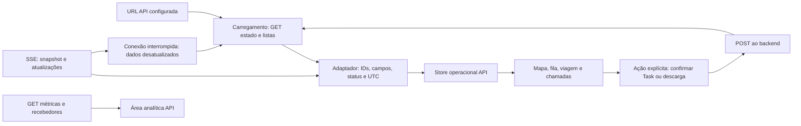
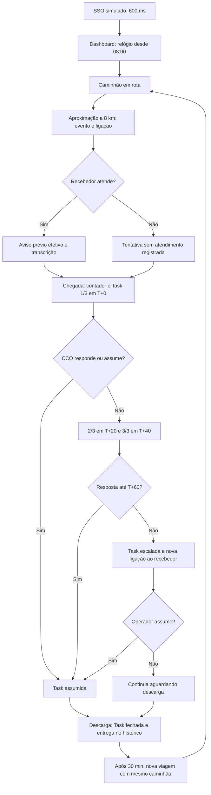
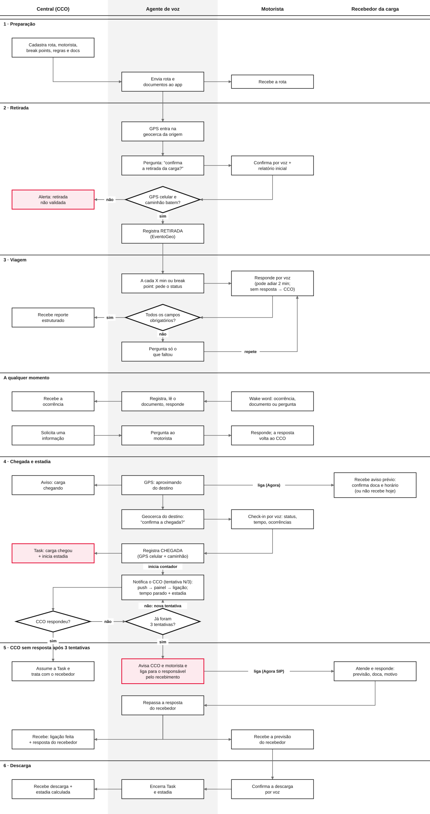

# AvisAI Web · Arquitetura

Aplicação React + Vite + TypeScript strict. O zustand mantém o estado exibido; React Router organiza as telas; Recharts exibe as séries da Demo; i18next fornece pt-BR e inglês. Tailwind v4 define os tokens no CSS, sem configuração Tailwind ou PostCSS separada. A operação usa **API** ou **Demo**, com origem indicada. API usa indicadores do servidor; SSO e metadados fiscais permanecem MOCK.

## Estrutura e dependências

```text
src/
├── app/              App, inicialização do motor e rotas com guarda de sessão
├── assets/locales/   Traduções pt-BR e en
├── components/       Layout, navegação, controles de demo e UI compartilhada
├── features/
│   ├── auth/         Sessão SSO simulada
│   ├── tasks/        Fila, tentativas e ação Assumir
│   ├── fleet/        Mapa, seleção e frota da fonte operacional escolhida
│   ├── trips/        Eventos e detalhes da viagem
│   ├── dispatch/     Publicação, atribuição, motoristas e anexos reais
│   ├── receivers/    Ranking de espera por recebedor
│   ├── metrics/      Agregações, KPIs e gráficos
│   └── calls/        Ligações e transcrições
├── lib/              Parâmetros de negócio e inicialização do i18n
├── pages/            Login, Dashboard, Métricas, Recebedores, Ligações e Viagem
├── services/
│   ├── api/          Contratos, validação de respostas e transporte REST/SSE
│   ├── analytics/    Indicadores/ranking API, atualização e estado de erro
│   ├── operations/   Seleção API/Demo, adaptação e store operacional API
│   └── mock/         Dados, histórico, snapshots rodoviários, dossiê e motor
├── types/            Contratos de eventos, operação e coordenadas
└── utils/            Estadia, formatação e geometria
```

Dependência: `pages → features → components/services/lib/utils/types`. O `index.ts` é a entrada pública de cada feature; uma feature não importa os arquivos internos de outra. O cálculo de estadia **da Demo** pertence somente a `utils/stay.ts`, incluindo usos no histórico, fila, viagem e métricas. No modo API, resumos financeiros e contadores vêm do servidor, sem aplicação da fórmula local.

## Seleção de fonte e fluxo API

`VITE_API_BASE_URL` vazia inicia a Demo. Preenchida, aponta para a raiz do backend e inicia o modo API, por exemplo `http://127.0.0.1:8000`. Alterar a `.env` exige reiniciar o Vite. A API indisponível produz carregamento/erro e retry; **Usar demo** é uma ação explícita. Não há fallback automático ou execução simultânea do motor mock para completar a operação recebida.

`services/api/client.ts` valida respostas e faz o transporte REST/SSE. O cliente busca `/cco/estado`, lê Tasks, chamadas, eventos e mensagens por rota, obtém `/rotas/{id}` para o trajeto e acompanha `/cco/stream` por SSE. `services/operations/adapter.ts` normaliza nomes de campos, status e datas UTC para os contratos do painel, preservando IDs e a fonte. `services/operations/runtime.ts` mantém o store API e a reconciliação; sua entrada pública seleciona a fonte consumida pelas features. Componentes não enviam posições nem executam cálculos de negócio do backend.



Uma reconexão refaz as leituras; uma reconciliação REST a cada 15 segundos cobre perdas do stream. O SSE oferece um snapshot inicial e atualizações, mas não publica `id:`, cursor ou replay de mensagens perdidas. Durante a interrupção, o painel identifica dados desatualizados; não avança posição, tentativas ou contador por inferência local.

REST e SSE são conciliados por entidade: uma atualização de GPS recebida durante a leitura não impede a renovação de chamadas, eventos ou outras coleções. As confirmações de Task, rotas descarregadas e estadias encerradas têm proteção contra regressão por respostas concorrentes. Assim, a reconciliação não descarta a resposta REST inteira quando apenas uma entidade recebeu atualização ao vivo.

**Assumir** envia `POST /tasks/{task_id}/confirmar` com `confirmado_por`; **Confirmar descarga** envia `POST /rotas/{rota_id}/descarga` com `por`. **Enviar mensagem ao motorista** envia `POST /rotas/{rota_id}/mensagens`; o serviço do agente registra cada etapa e tenta voz. A ação explícita de ligação usa `POST /cco/rotas/{rota_id}/ligar`; ela não simula sucesso e expõe Twilio, fallback Agora e escalada no feed. O painel não usa reset, chegada manual ou envio de GPS.

O backend trabalha com segundos para as tentativas e timestamps UTC. `/cco/estado` e SSE incluem `Z`; respostas diretas de modelos podem omitir o sufixo, embora representem UTC. Os contadores e resumos de estadia incluem capacidade, franquia, tarifa e aceleração do servidor; nenhum valor financeiro é recalculado com parâmetros da Demo.

O snapshot limita Tasks, estadias, chamadas e ocorrências a 20 por coleção e eventos a 50. As listas de Tasks e chamadas retornam até 50, sem paginação; o cliente pede até 200 eventos por `limite`. Esses conjuntos não comprovam completude para KPIs históricos. Uma lista/detalhe indisponível com 404/405 mantém os dados do snapshot API, sem criar MOCK; outras falhas produzem erro. O contrato completo, APIs existentes fora da UI e pendências estão em [INTEGRACAO-BACKEND.md](INTEGRACAO-BACKEND.md).

No modo API, o login lista `/usuarios?role=cco` e envia o e-mail escolhido para `/auth/sso`, que devolve token e identidade MOCK. O perfil tem ID estável persistido; desconhecidos retornam 404. No celular, `/usuarios?role=driver` fornece a seleção; trocar perfil exige fechar as conexões anteriores e invalidar respostas pendentes, conforme o modelo mobile. Na Demo, a sessão é local. Os endpoints operacionais atuais não verificam autorização e a configuração CORS permite qualquer origem. Autenticação real e acesso por empresa/motorista/viagem/arquivo são pendências antes de produção.

## Publicação, pedidos e anexos

`features/dispatch` cruza `GET /usuarios?role=driver` com `GET /motoristas` e só exibe perfis persistidos que possuam vínculo operacional. O CCO publica a rota já atribuída a um desses usuários ou a reatribui depois; a tela não cadastra motoristas nem chama `POST /motoristas`. O backend cria o trajeto linear e define o estado resultante; o frontend não escolhe uma fixture rodoviária para completar essa rota.

O dossiê consulta `/api/documents` para os metadados fiscais MOCK, `/rotas/{id}/solicitacoes` para pedidos/respostas da central e `/rotas/{id}/mensagens` para a thread CCO→motorista. A mensagem é falada somente pela sessão de agente existente; se ela estiver indisponível, o backend registra a decisão e aciona a cascata de chamada. A página `/operator` é a exceção deliberada: ela usa Agora Web RTC para atender o fallback do agente, com permissão de microfone do navegador.

Arquivos reais têm listagem/upload em `/rotas/{id}/arquivos` e download por ID. `arquivo_adicionado` sinaliza refetch, sem carregar binário no SSE. Metadados ficam no banco; conteúdo em `ARQUIVOS_DIR`, montado no Compose em `/app/data/arquivos`. Reset preserva anexos e não existe DELETE/versionamento. Banco e volume precisam de backup conjunto; não há transação atômica completa entre banco e filesystem.

O backend alterado é `/home/henry/Documents/avisai/backend`, fora do checkout web. O modelo mobile em [CONTRATO-MOBILE.md](CONTRATO-MOBILE.md) usa IDs do backend, WS por motorista, leitura autoritativa da rota e download `Blob`; não constitui um app mobile completo.

## Fluxo de dados da Demo

O motor avança em minutos simulados e produz viagens, Tasks, ligações e eventos. Caminho, distância e posição usam a geometria rodoviária local do recebedor: o motor e o marcador do mapa compartilham `trip.progress`. A velocidade permanece 70 km/h, sem usar a duração estimada pelo provedor do snapshot. Timestamps do domínio são derivados do relógio da simulação. Cada evento recebe ID e chave de idempotência; estes identificam a evidência local, sem implicar sincronização com um servidor.

Uma viagem descarregada gera uma única entrega concluída. As agregações combinam as 63 entregas iniciais com as concluídas na sessão. Viagens em andamento aparecem no mapa e na fila, mas não entram no denominador das métricas de entregas concluídas.

O histórico usa seed 42. O simulador usa geradores pseudoaleatórios independentes por domínio e caminhão, com sementes derivadas da base 42. A progressão da demo é reproduzível; a ação manual do operador e a mudança do slider alteram os resultados posteriores.

## Origem dos dados e mapa

| Área | Modo API | Modo Demo |
|---|---|---|
| Operação, Tasks e eventos | Estado e mensagens publicados pelo backend | Motor local |
| Estadia | Resumo calculado no servidor, sem recálculo no cliente | Fórmula única em `utils/stay.ts` |
| Mapa base | Google Maps JavaScript API opcional | Google Maps JavaScript API opcional |
| Caminho e posição | `trajeto` e último GPS fornecidos pela API, sem inferência | Snapshots OSRM/OpenStreetMap locais e progresso simulado |
| Alertas e decisões do agente | SSE + feed, toast e painel de decisões | Cada sucesso/falha contém prioridade, horário e resultado; não há ação silenciosa |
| Chamada do agente | Twilio PSTN, seguido de Agora RTC em `/operator` | Depende de credenciais e URL pública; ausência de configuração é exibida, não simulada |
| KPIs e ranking | `/api/metrics` e `/api/receivers`; sem série diária/valor cobrado | 63 entregas com seed fixa e entregas da sessão |
| SSO | `/auth/sso`, token fake e identidade MOCK | Sessão local fictícia |
| Dossiê | Campos API, notas fiscais MOCK, pedidos e anexos reais | Carga, notas e mensagens fictícias |

O backend pode estar executando seus próprios simuladores e serviços. Consumir sua API não comprova GPS, telefone ou documento real. O seed atual contém uma rota de 28 t com caminho linear de 41 pontos; o painel mostra essa geometria como fornecida, sem convertê-la em estrada ou substituir as posições ausentes.

O mapa carrega as bibliotecas de mapa e marcadores do SDK JavaScript do Google diretamente, sem biblioteca adicional, usando `VITE_GOOGLE_MAPS_API_KEY` da `.env`. `VITE_GOOGLE_MAPS_MAP_ID` é opcional, com `DEMO_MAP_ID` como padrão. Variáveis de cliente ficam expostas no bundle; a chave deve ter restrições de HTTP referrer e de Maps JavaScript API. A configuração da conta, habilitação da API e cobrança ficam a cargo do usuário.

Na Demo, as cinco geometrias de `services/mock/routes.ts` foram obtidas uma vez via OSRM/OpenStreetMap e versionadas como fixtures. Registram provedor, atribuição, data, URL de origem, extremos pedidos/ajustados e distâncias. O comprimento usado pelo motor é a soma das distâncias dos segmentos; pode diferir ligeiramente da distância de metadados do OSRM. Os extremos ajustados à via são compartilhados pelo motor e pelo mapa. Uma rota ausente é erro de dados, sem substituir o trajeto por uma reta.

O caminho da Demo é preparado em memória por recebedor e reutilizado entre caminhões e telas. Sua posição interpola os segmentos de acordo com `trip.progress`, e a aproximação usa 8 km restantes nesse mesmo caminho. No modo API, o detalhe da rota fornece a geometria e as posições chegam do servidor. O fluxo de monitoramento não carrega a biblioteca `routes` nem chama `computeRoutes`; não depende de Routes API ou de OSRM online.

O Dashboard mantém o mapa como área principal, com lista pesquisável/filtrável da frota e dossiê selecionado. A feature `fleet` controla a seleção; a entrada pública de `trips` apresenta carga, notas e comunicações, identificando conteúdo sem contrato como MOCK. A página de viagem usa essas entradas públicas para mapa e dossiê. Dados ilustrativos não modificam capacidade, valor de estadia ou eventos de nenhuma das fontes.

O SDK do mapa depende de rede externa; fontes, traduções e caminhos da Demo permanecem locais. O modo API também depende do backend configurado. Sem chave Google ou se o SDK falhar, o aviso traduzido preserva a lista, o dossiê e a operação da fonte selecionada.

Referências: [carregamento do SDK](https://developers.google.com/maps/documentation/javascript/load-maps-js-api), [OSRM](https://project-osrm.org/) e [© OpenStreetMap contributors](https://www.openstreetmap.org/copyright).

## KPIs e séries

No modo API, `services/analytics` busca `/api/metrics` e `/api/receivers`, com reconciliação periódica de 15 s e atualização manual. Erro preserva dados anteriores identificados; não troca pela Demo. A média de espera usa estadias encerradas, o total devido inclui abertas e escaladas contam eventos históricos. Latência é somente LLM até o primeiro trecho. Nulos permanecem sem amostra; séries diárias e valor cobrado são indisponíveis. A [matriz](INTEGRACAO-BACKEND.md) detalha as populações do servidor.

As fórmulas abaixo pertencem exclusivamente à **Demo**; não reinterpretam valores do backend ou seus percentis.

O conjunto **D** contém as entregas concluídas do histórico inicial e da sessão. O conjunto **C** contém as ligações históricas e as ligações da sessão. Razões sem observações retornam zero; o tempo de ação usa somente entregas com ação do CCO registrada.

| KPI | Fórmula / população | Informação complementar |
|---|---|---|
| Horas paradas por entrega | `sum(D.waitMin) / count(D) / 60` | Chegada até descarga |
| Estadia devida | `sum(stayValue(waitMin, capacityTons))` em D | Cobrada: soma somente onde `stayCharged` |
| Recebedor avisado antes | `count(D.notifiedBeforeArrival) / count(D) × 100` | Aviso atendido antes da chegada |
| Tempo médio até ação do CCO | Média de `D.ccoActionMin` não nulos | Tasks escaladas agora |
| Latência da voz p50 | Percentil 50 de `D.voiceLatencyMs` | Percentil 95 |
| Ligações atendidas | `count(C.answered) / count(C) × 100` | Inclui aviso prévio e escalada |
| Reporte completo na primeira resposta | `count(D.reportCompleteFirst) / count(D) × 100` | Resultado sintético de reporte |
| Tasks escaladas | Quantidade de Tasks atualmente com status `escalated` | Não inclui assumidas ou fechadas |
| Contatos CCO ↔ motorista evitados | `sum(D.contactsAvoided)` | Estimativa fictícia da demo |
| Total de entregas | `count(D)` | Histórico e sessão |

Percentis usam **nearest-rank**: ordenar os valores e selecionar a posição `ceil((p / 100) × n)`, com `p = 50` ou `95` e posição iniciando em 1. Por dia, a linha apresenta a espera média em horas e o percentual de avisados em eixos distintos; as barras mostram as somas de estadia devida e cobrada. O ranking agrupa D por recebedor e ordena pela maior espera média; sua taxa de atendimento usa as ligações de C daquele recebedor.

O selo “acima da franquia” usa espera média superior a 300 min. A composição controlada das entregas históricas ilustra redução da espera, sem demonstrar causalidade ou calibrar um modelo real.

## Operação da Demo no CCO



### Fluxo completo do produto

O diagrama acima cobre só o que a Demo executa no painel. O fluxograma abaixo mostra o produto inteiro em quatro raias (CCO, agente de voz, motorista e recebedor), da preparação da rota à descarga, incluindo a ligação ao recebedor após três avisos sem resposta do CCO. Ele vem do repositório de ideias do time ([`chapahalls-ideas`](https://github.com/chapahalls/chapahalls-ideas/tree/main/ideas/parceiro-de-estrada)); voz, GPS e mobile ficam fora deste painel. Onde houver diferença, valem as regras da Demo deste repositório ([REGRAS-DE-NEGOCIO.md](REGRAS-DE-NEGOCIO.md)).



## Roteiro de demo · dois minutos

1. **0:00–0:20:** entrar com SSO; mostrar a faixa de indicadores, lista da frota e mapa. O resumo completo dos dez KPIs fica abaixo; o histórico já alimenta os gráficos.
2. **0:20–0:50:** selecionar um caminhão pela lista ou marcador; acompanhar a rota e abrir as abas de carga, notas e comunicações fictícias do dossiê.
3. **0:50–1:30:** observar a fila avançar de 1/3 para 2/3 e 3/3. Manter os 35% padrão; opcionalmente usar 0% para impedir novas respostas automáticas.
4. **1:30–1:50:** mostrar uma escalada e sua segunda ligação; clicar em **Assumir** para encerrar as novas tentativas.
5. **1:50–2:00:** abrir Métricas e Recebedores; mostrar espera, estadia devida/cobrada e os perfis para renegociação com o embarcador.

Pausar congela o relógio durante uma explicação. A descarga pode ocorrer depois dos dois minutos: os dados históricos permitem demonstrar os indicadores desde o início.

## Verificação

`npm test` cobre as transições determinísticas da Demo, fronteiras da estadia, histórico e agregações; os testes de integração local devem conferir adaptação dos contratos, UTC, separação das fontes e preservação de valores financeiros. `npm run typecheck` e `npm run build` validam os contratos e o bundle. A revisão no navegador verifica todas as telas, pt-BR/en, navegação por teclado, controles em tela pequena e uma escalada durante dois minutos da simulação padrão.

Verificar aviso sem chave, falha do SDK, busca/filtros, sincronização entre lista e marcador, seleção do dossiê, abas por teclado e layouts desktop/móvel. Com credenciais válidas, verificar mapa base e polylines locais, sem solicitações de rota durante ticks ou navegação. Os testes de geometria conferem distância, extremos, interpolação e chegada no mesmo caminho utilizado pelo mapa.

Para API, verificar carregamento, erro/retry, escolha explícita da Demo, snapshot, SSE/reconexão, dados sem GPS, labels de origem, confirmação de Task e descarga. POSTs precisam de validação controlada porque alteram o estado do backend; nenhum teste do cliente deve acionar telefonia ou reset automaticamente.

Em 22/11/2026, banco e API foram iniciados localmente, sem túnel. `/cco/estado`, `/rotas/1`, `/tasks`, `/ligacoes` e `/eventos?limite=200` retornaram HTTP 200; `snapshot` e `contador` foram observados no SSE. No navegador, foram conferidos uma rota de Carlos com 28 t e NF `000.482.913`, ausência de GPS, Google Maps base com o caminho linear de 41 pontos da API, pt-BR/en e identificação de MOCK. Eventos de voz publicados pelo backend também chegaram ao vivo, sem início de voz pelo painel.

Confirmação de Task e descarga foram verificadas com transportes controlados nos testes. Nenhum desses POSTs foi executado no backend ativo, pois não havia Tasks/estadias para essas ações. A cobertura e os limites dessa validação estão em [INTEGRACAO-BACKEND.md](INTEGRACAO-BACKEND.md).
