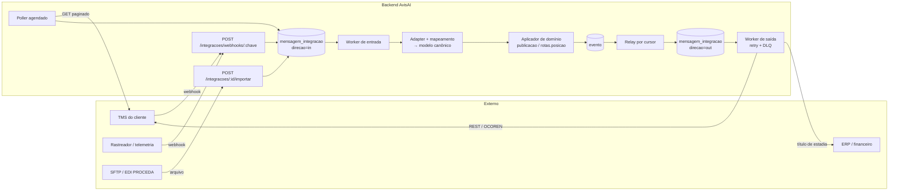

# Plano · Conectores TMS por adapters

Planejamento para fechar a lacuna **“TMS/ERP, rastreador e telefonia do cliente”** de [rodar-web-o-que-falta.md](rodar-web-o-que-falta.md) (seção 2) e a hipótese H3. Hoje rotas entram só pelo painel (`POST /rotas`) e a posição do rastreador só pelo `POST /rotas/{id}/posicao` com `fonte:"rastreador"`; não há conector com sistema do cliente.

**Objetivo:** qualquer TMS, rastreador ou ERP entra por **configuração** de um adapter pré-pronto (webhook, REST, planilha, EDI). Código novo só quando o sistema exige protocolo que a configuração não cobre (OAuth fora do padrão, SOAP, layout próprio), e mesmo assim como um adapter isolado que passa na mesma suíte de contrato.

Plano de testes: [PLANO-TESTES-CONECTORES.md](PLANO-TESTES-CONECTORES.md).

> Estado deste documento: **planejamento**. Nada aqui está implementado. Endpoints e tabelas abaixo são propostas; não devem ser chamados pelo painel nem citados como disponíveis até existirem.

---

## 1. Princípios

1. **Modelo canônico único.** O núcleo do AvisAI só conhece `Viagem`, `Parada`, `Posicao`, `Ocorrencia`, `EstadiaEncerrada` e `DocumentoFiscalRef`. Cada adapter traduz de/para o formato do sistema externo. Mudou a API do TMS, muda só o adapter ou o mapeamento.
2. **Portas e adapters, como já é no backend.** `app/portas.py` já define `Protocol` com um adaptador real e um fake (LiveKit, LLM, Twilio). Os conectores seguem o mesmo padrão e entram no `Container`.
3. **Persistir antes de processar.** Toda mensagem recebida ou a enviar é gravada (inbox/outbox) antes de qualquer efeito. Resposta rápida ao parceiro, processamento por worker.
4. **Idempotência sempre, exatamente uma vez nunca prometido.** Entrega *at-least-once* com chave de idempotência dos dois lados, alinhado a `docs/CONTRATO-MOBILE.md`.
5. **Retentativa só para erro transitório.** Erro de negócio (400/422) não é repetido sozinho; vai para fila de erro funcional com ação explícita do operador.
6. **Os valores financeiros vêm do servidor.** Estadia, tarifa e capacidade enviadas ao TMS/ERP saem de `servicos`/`dominio/estadia.py`; o conector não recalcula nada.
7. **Nada fabricado.** Sem coordenadas e sem código de local cadastrado, o conector rejeita com erro funcional (`COORDENADAS_AUSENTES`). A geocodificação (`GET /geocodificacao`, porta `Geocodificador`) só é usada automaticamente quando o conector liga `geocodificar_endereco` **e** o provedor devolve um único candidato; o vínculo (`geo.fonte = geocodificacao`, provedor e id do lugar) fica gravado na rota. Nunca infere GPS. Trajeto recebido do TMS é usado como fornecido.
8. **Segredo fora do banco e do git.** O banco guarda só a *referência* ao segredo (`segredo_ref` = nome da variável de ambiente ou do secret manager). Regra E7.
9. **Homologação antes de produção.** Todo conector nasce em modo `homologacao`: traduz, valida e audita, mas não altera rotas. Promover para `producao` é ação explícita.

---

## 2. Arquitetura



### 2.1 Pacote proposto no backend

`rodar-backend/backend/app/conectores/` (o `CLAUDE.md` deste repo cita `avisai/backend`; o checkout atual está em `rodar-backend/backend`).

```text
app/conectores/
├── canonico.py        Modelos Pydantic do modelo canônico + validadores (placa, CNPJ, chave NF-e)
├── portas.py          Protocols: FonteViagens, ReceptorWebhook, DestinoEventos, FontePosicoes
├── registro.py        Catálogo de tipos de adapter: @registrar("webhook_generico")
├── mapeamento.py      DSL de de-para (JMESPath + transformações em lista branca)
├── classificacao.py   HTTP/exceção → sucesso | aguardando_callback | funcional | transitorio | credencial
├── seguranca.py       HMAC, API key, allowlist de host, limite de corpo, mascaramento de PII
├── entrada.py         Pipeline: inbox → adapter → validação → vínculo externo → aplicador
├── saida.py           Relay evento → outbox; tradução para o formato do destino
├── worker.py          Laço com SELECT … FOR UPDATE SKIP LOCKED, backoff, DLQ
├── servico.py         CRUD de conectores, teste a seco, estado/saúde
└── adapters/
    ├── fake.py               Simulador em memória (testes e Demo)
    ├── webhook_generico.py   Recebe JSON/HMAC, traduz por mapeamento
    ├── rest_generico.py      Polling paginado + envio REST por template
    ├── arquivo_csv.py        Importação de planilha (CSV/XLSX → canônico)
    ├── rastreador_generico.py Posições e cercas via webhook/polling
    └── edi_proceda.py        NOTFIS (entrada) e OCOREN (saída), largura fixa, SFTP
app/api/integracoes.py  Rotas HTTP (admin + webhook)
```

### 2.2 Portas (capacidades)

Um adapter declara o que sabe fazer; o núcleo só chama o que foi declarado. Nenhum adapter precisa implementar tudo.

```python
class Capacidade(StrEnum):
    VIAGENS_WEBHOOK = "viagens_webhook"     # recebe viagens por push
    VIAGENS_PULL = "viagens_pull"           # busca viagens por polling
    POSICOES = "posicoes"                   # GPS/telemetria do caminhão
    OCORRENCIAS_SAIDA = "ocorrencias_saida" # chegada, ocorrência, descarga → parceiro
    ESTADIA_SAIDA = "estadia_saida"         # estadia encerrada → TMS/ERP
    ARQUIVO = "arquivo"                     # importação CSV/EDI

class ReceptorWebhook(Protocol):
    def autenticar(self, cabecalhos: Mapping[str, str], corpo: bytes) -> None: ...  # levanta CredencialInvalida
    def chave_idempotencia(self, cabecalhos, corpo_json: dict) -> str: ...
    def traduzir(self, corpo_json: dict) -> list[MensagemCanonica]: ...

class FonteViagens(Protocol):
    async def puxar(self, cursor: str | None) -> Pagina[MensagemCanonica]: ...  # Pagina tem proximo_cursor

class DestinoEventos(Protocol):
    def suporta(self, saida: SaidaCanonica) -> bool: ...
    def montar(self, saida: SaidaCanonica) -> RequisicaoSaida: ...  # método, URL relativa, corpo, cabeçalhos
    def interpretar(self, resposta: RespostaHttp) -> ResultadoEnvio: ...  # usa classificacao.py por padrão
```

`montar` e `interpretar` são puros; o worker é quem faz o I/O (httpx) com timeout, rate limit e allowlist. Isso deixa todo adapter testável sem rede.

### 2.3 Modelo canônico

```python
class ViagemCanonica(BaseModel):
    id_externo: str                 # ID no TMS; nunca substitui o ID numérico do backend
    versao_externa: str | None      # updated_at/versão do TMS para descartar atualização velha
    acao: Literal["upsert", "cancelar"] = "upsert"
    placa: str                      # normalizada AAA0A00 / AAA0000
    motorista_ref: RefExterna | None   # id externo, e-mail ou telefone E.164 (sem CPF)
    origem: LocalCanonico
    destino: LocalCanonico          # inclui janela de descarga
    recebedor: RecebedorCanonico    # empresa, contato, telefone_e164
    carga_t: float = Field(gt=0)
    capacidade_t: float | None
    carga_descricao: str = ""
    documentos: list[DocumentoFiscalRef] = []   # chave NF-e/CT-e (44 dígitos, DV mod 11)
    trajeto: list[tuple[float, float]] | None    # usado como fornecido, sem encaixe em estrada

class LocalCanonico(BaseModel):
    nome: str
    codigo_externo: str | None      # código do CD/cliente no TMS
    cnpj: str | None
    cidade_ibge: str | None         # 7 dígitos
    lat: float | None; lng: float | None   # obrigatórios após resolver o código do local

class PosicaoCanonica(BaseModel):
    id_evento_externo: str
    placa: str
    lat: float; lng: float
    registrada_em: datetime         # horário do equipamento, UTC
    velocidade_kmh: float | None; ignicao: bool | None
    cerca: CercaCanonica | None     # entrada/saída informada pelo provedor
```

Saídas (`SaidaCanonica`) são geradas a partir dos eventos já gravados: `chegada`, `ocorrencia`, `escalada_recebedor`, `descarga` e `estadia_encerrada` (valores do servidor: horas, franquia, excedente, valor). Nada de cobrança: o backend não registra estadia cobrada.

### 2.4 Mapeamento declarativo (o que torna “qualquer sistema” possível)

`webhook_generico`, `rest_generico` e `arquivo_csv` não têm regra de nenhum TMS no código. A regra fica num JSON versionado por conector, validado ao salvar e testável a seco:

```json
{
  "versao": 1,
  "entrada": {
    "viagem": {
      "seletor_lista": "data.trips[]",
      "id_externo": "id",
      "versao_externa": "updated_at",
      "placa": "vehicle.plate | maiusculas | sem_separador",
      "motorista_ref.email": "driver.email",
      "origem.codigo_externo": "origin.site_code",
      "destino.codigo_externo": "destination.site_code",
      "destino.janela": "destination.window.start",
      "recebedor.empresa": "destination.company_name",
      "recebedor.telefone_e164": "destination.contact_phone | telefone_e164('BR')",
      "carga_t": "cargo.weight_kg | dividir(1000)",
      "documentos[].chave": "invoices[].access_key | somente_digitos"
    },
    "acao": { "campo": "status", "cancelar_quando": ["CANCELLED", "VOID"] },
    "idempotencia": "event_id"
  },
  "locais": {
    "CD-SOROCABA-01": { "nome": "CD Sorocaba", "lat": -23.5015, "lng": -47.4526 }
  },
  "saida": {
    "chegada": {
      "metodo": "POST",
      "caminho": "/trips/{id_externo}/events",
      "corpo": { "type": "ARRIVED", "at": "{ocorrido_em}", "source": "avisai" }
    },
    "estadia_encerrada": {
      "metodo": "POST",
      "caminho": "/trips/{id_externo}/detention",
      "corpo": { "hours": "{horas_paradas}", "excess_hours": "{horas_excedentes}", "amount_brl": "{valor}" }
    }
  }
}
```

- **Expressões:** JMESPath (biblioteca pura, sem execução de código). Transformações numa lista branca (`maiusculas`, `somente_digitos`, `dividir`, `telefone_e164`, `data_iso`, `mapa_status`). Nada de `eval`.
- **Templates de saída:** placeholders sobre a `SaidaCanonica`; campo desconhecido é erro de validação ao salvar, não string vazia em produção.
- **Locais:** o de-para de código do CD para coordenadas resolve o caso comum de TMS que não manda lat/lng. Sem código e sem coordenadas, erro funcional.
- **Versão:** toda alteração gera nova `versao`; a mensagem guarda com qual versão foi traduzida, para auditoria e reprocessamento.

Adapters “por fornecedor” só existem quando o JSON não basta e, mesmo assim, herdam do genérico e sobrescrevem só autenticação ou paginação.

### 2.5 Fluxo de entrada

1. **Recebimento** (`POST /integracoes/webhooks/{chave_publica}`): a URL usa uma chave aleatória por conector (32 bytes, rotacionável), não o ID sequencial, para não permitir enumerar conectores. A ordem é:
   1. `Content-Type` JSON (senão 415) e corpo ≤ 1 MiB (senão 413), lidos como **bytes brutos**: a assinatura é verificada antes de qualquer parse, porque reserializar o JSON muda os bytes e invalida o HMAC.
   2. Autenticação conforme o **perfil de assinatura do conector**, já que cada provedor assina de um jeito:
      ```json
      { "assinatura": { "tipo": "hmac", "algoritmo": "sha256", "cabecalho": "X-Signature",
                        "formato": "hex", "prefixo": "sha256=", "cabecalho_timestamp": "X-Timestamp",
                        "base": "{timestamp}.{corpo}", "tolerancia_s": 300 } }
      ```
      Perfis prontos: `avisai` (padrão: `X-AvisAI-Assinatura: t=<epoch>,v1=<hex>`), `hmac_simples` (HMAC do corpo, sem timestamp), `api_key` (cabeçalho configurável) e `basic`. Comparação sempre em tempo constante.
   3. **Timestamp:** só é exigido se o perfil tiver `cabecalho_timestamp`. Fora da tolerância responde 401. Provedor que reenvia com a assinatura original depois da janela precisa de `tolerancia_s` maior: a proteção contra replay é a chave de idempotência, não a janela.
   4. Calcula a chave de idempotência (campo do mapeamento ou SHA-256 do corpo bruto) e grava `mensagem_integracao(direcao=in, status=recebida)` com o corpo mascarado.
   - Nova: `202 {"status":"recebida","mensagem_id":…}`.
   - Repetida (mesma chave): `200 {"status":"duplicada","mensagem_id":<original>}`. 2xx para que o provedor pare de reenviar; o `POST /events` do app continua com seu 409 próprio.
   - Assinatura ou credencial inválida: 401 problem+json. Grava só metadados (horário, IP, motivo), nunca o corpo.
   - Chave desconhecida ou conector desativado: 404, sem distinguir os dois casos.
   - Conector `pausado` (credencial de saída inválida, manutenção): `503` com `Retry-After`, para o provedor guardar e reenviar depois em vez de perder o evento.
2. **Worker** pega a mensagem com `FOR UPDATE SKIP LOCKED`, roda `adapter.traduzir` com a versão do mapeamento e valida o canônico. Falha de validação vira `erro_funcional` com `errors[]` no formato RFC 9457.
3. **Vínculo externo:** procura `vinculo_externo(conector, "rota", id_externo)`.
   - Não existe: `publicacao.publicar(...)` e grava o vínculo na mesma transação.
   - Existe: compara `versao_externa`; mais velha é descartada (`status=ignorada_desatualizada`). Rota em `publicada`/`planejada` aceita alteração; depois de `em_transito`, só campos não operacionais (descrição, documentos); demais viram erro funcional `ROTA_EM_ANDAMENTO`.
   - `cancelar`: chama o mesmo serviço de `POST /rotas/{id}/cancelar` (status `cancelada`, motivo `Cancelado no TMS <nome>: <motivo>`, `por = integracao:<conector>`). Se a rota já está `no_destino`, `descarregada` ou `cancelada`, o backend responde conflito: a mensagem vira `erro_funcional` `CANCELAMENTO_FORA_DE_HORA` e abre Task para o CCO decidir.
4. **Motorista:** casa por vínculo externo, e-mail ou telefone já cadastrados. Sem casamento, a rota entra `publicada` e o CCO atribui no despacho. Criação automática de motorista fica desligada por padrão.
5. **Posição de rastreador:** placa → rota ativa (não descarregada) com aquela placa; chama o mesmo serviço de `POST /rotas/{id}/posicao` com `fonte="rastreador"`. Mantém o contrato atual: rastreador não altera ETA/estado do celular. Cerca informada pelo provedor vira evento informativo; posição com `registrada_em` anterior à última é ignorada.
6. **Evento:** cada efeito registra `evento` (`integracao_viagem_recebida`, `integracao_rejeitada`), que já aparece no feed do CCO via SSE. Tipos novos entram em `TipoEvento` e no tradutor do painel.

### 2.6 Fluxo de saída

- **Relay por cursor:** em vez de mexer em todos os serviços, um relay lê a tabela `evento` por `id > cursor` para cada conector ativo com capacidade de saída e gera linhas de outbox. Para não pular eventos de transações que commitam fora de ordem, lê só eventos com mais de 5 s e a unicidade `(conector_id, direcao, chave)` absorve releituras.
- **Chave de idempotência:** `avisai-{conector_id}-evt-{evento_id}`, enviada em `Idempotency-Key` e no corpo quando o template pedir.
- **Envio:** worker com timeout de 10 s, rate limit por conector (token bucket configurável), allowlist de host.

| Resposta | Estado da mensagem | Ação automática |
|---|---|---|
| 200/201 | `enviada` | Guarda ID externo devolvido em `vinculo_externo` |
| 202 | `aguardando_callback` | Espera webhook de retorno ou consulta `Location` se configurado |
| 409 | `enviada` (idempotente) | Trata como sucesso e vincula o ID existente |
| 400/404/422 | `erro_funcional` | Não repete. Aparece na tela de integrações para correção |
| 401/403 | `erro_credencial` | Não repete e **pausa o conector** (estado `erro`) até nova credencial |
| 408/425/429/5xx, timeout, DNS | `erro_transitorio` | Repete respeitando `Retry-After`; backoff 1 min, 5 min, 15 min, 1 h, 6 h com jitter |
| 6 transitórios seguidos | `dlq` | Para de tentar; reprocessar é ação explícita |

### 2.7 Persistência (migration nova)

| Tabela | Campos principais | Observações |
|---|---|---|
| `conector` | `id`, `empresa_id`, `tipo`, `nome`, `modo` (`homologacao`/`producao`), `ativo`, `capacidades` JSON, `config` JSON, `mapeamento_versao`, `segredo_ref`, `base_url`, `hosts_permitidos` JSON, `estado` (`nao_configurado`/`ok`/`degradado`/`erro`/`pausado`), `ultimo_erro`, `ultima_atividade_em` | Segredo nunca no banco |
| `conector_mapeamento` | `conector_id`, `versao`, `conteudo` JSON, `criado_em`, `criado_por` | Histórico imutável |
| `mensagem_integracao` | `id`, `conector_id`, `direcao`, `tipo`, `chave_idempotencia`, `status`, `tentativas`, `proxima_tentativa_em`, `http_status`, `corpo` JSON mascarado, `canonico` JSON, `erro` JSON (problem details), `mapeamento_versao`, `evento_id`, `rota_id`, `correlation_id`, `criada_em`, `processada_em` | `UNIQUE(conector_id, direcao, chave_idempotencia)`; índice em `(status, proxima_tentativa_em)` |
| `vinculo_externo` | `conector_id`, `entidade` (`rota`/`motorista`/`local`/`ocorrencia`), `id_interno`, `id_externo`, `versao_externa` | `UNIQUE(conector_id, entidade, id_externo)`; preserva o ID numérico do backend |
| `cursor_integracao` | `conector_id`, `recurso`, `valor`, `atualizado_em` | Polling e relay |

Status de `mensagem_integracao`: entrada `recebida → processada | processada_homologacao | duplicada | ignorada_desatualizada | erro_funcional`; saída `pendente → enviando → enviada | aguardando_callback | erro_funcional | erro_credencial | erro_transitorio → dlq`.

Retenção: corpo bruto 90 dias em homologação/produção (configurável), depois só metadados. CPF, telefone e e-mail mascarados antes de gravar o corpo (`***.***.***-00`, `+55******0002`).

### 2.8 Endpoints propostos

| Método e caminho | Quem | Uso |
|---|---|---|
| `GET /integracoes` | CCO (leitura) | Lista conectores com estado, capacidades, modo, contadores 24 h e último erro. Alimenta a tela de integrações |
| `GET /integracoes/tipos` | CCO | Catálogo de adapters registrados e o schema de configuração de cada um |
| `POST /integracoes` · `PATCH /integracoes/{id}` | papel `cco` (depois `admin`) | Cria/edita; valida config e mapeamento; nasce em `homologacao` |
| `POST /integracoes/{id}/testar` | papel `cco` | Teste a seco: recebe um payload exemplo, devolve o canônico e os erros. Não grava em `rota` |
| `POST /integracoes/{id}/promover` | papel `cco` | `homologacao → producao`; exige pelo menos uma mensagem processada sem erro |
| `POST /integracoes/{id}/sincronizar` | papel `cco` | Dispara um ciclo de polling sob demanda |
| `POST /integracoes/webhooks/{chave_publica}` | parceiro (perfil de assinatura do conector) | Entrada push |
| `POST /integracoes/{id}/rotacionar-chave` | papel `cco` | Nova chave pública e novo segredo; a anterior vale por 24 h |
| `POST /integracoes/{id}/importar` | papel `cco` | Upload CSV/XLSX/EDI (multipart, limite como `ARQUIVOS_MAX_BYTES`) |
| `GET /integracoes/{id}/mensagens?status=&direcao=` | CCO | Auditoria paginada por cursor |
| `POST /integracoes/mensagens/{id}/reprocessar` | papel `cco` | Reprocessa `erro_funcional`/`dlq` com a versão atual do mapeamento; nova tentativa, mesma chave |

SSE: um evento novo `integracao` (`{conector_id, estado}`) quando o estado muda. Como é contrato do painel, entra em `services/api` e na matriz de `INTEGRACAO-BACKEND.md` junto com a implementação.

### 2.9 Segurança

- Webhook: HMAC-SHA256 sobre `t + "." + corpo bruto`, comparação em tempo constante, janela de 5 min; rotação com dois segredos ativos.
- Saída: só para `hosts_permitidos`; em produção bloqueia IP privado, loopback e link-local (SSRF). Sem seguir redirect para outro host.
- Limites: corpo de webhook 1 MiB; 50 itens por mensagem; rate limit de entrada por conector.
- Auth: endpoints admin exigem papel `cco` hoje. Separar por `empresa_id` é pendência já registrada no backend; o conector já nasce com `empresa_id` para não piorar o problema.
- Logs nunca imprimem segredo, assinatura ou corpo sem máscara.

### 2.10 Fila: Postgres agora, broker depois

O stack atual tem só Postgres. A fila fica em `mensagem_integracao` com `SKIP LOCKED`, worker como tarefa do `lifespan` ou processo separado (`python -m app.conectores.worker`, serviço próprio no `docker-compose.yml`). O worker depende de uma interface `Fila` pequena; trocar por RabbitMQ/SQS só será necessário acima de algumas centenas de mensagens por segundo, muito além da operação prevista (50 caminhões × 1 posição/30 s ≈ 2 msg/s).

---

## 3. Adapters pré-configurados

| Tipo | Direção | Transporte | Cobre | Fase |
|---|---|---|---|---|
| `fake` | entrada e saída | memória | Testes, homologação e a tela na Demo | 1 |
| `webhook_generico` | entrada | HTTPS + HMAC/API key | TMS e rastreadores que fazem push JSON | 2 |
| `rest_generico` | entrada (polling) e saída | HTTPS, API key, Basic, OAuth2 client credentials | TMS com API REST; envio de ocorrências/estadia | 2 |
| `arquivo_csv` | entrada | upload no painel | Quem não tem API: planilha com modelo baixável | 2 |
| `rastreador_generico` | entrada | webhook ou polling | Posições e cercas de gerenciadoras de risco | 3 |
| `edi_proceda` | entrada NOTFIS, saída OCOREN | SFTP ou upload | Embarcadores e transportadoras com EDI | 5 |
| `erp_generico` | saída | REST assíncrono | Estadia encerrada para contas a receber | 6 |

**Integrar um novo sistema, sem código (meta: 1 dia):**

1. Escolher o tipo (`webhook_generico`, `rest_generico` ou `arquivo_csv`).
2. Cadastrar conector em homologação, `base_url`, `hosts_permitidos` e `segredo_ref`; o segredo vai para a variável de ambiente do servidor.
3. Colar um payload real (anonimizado) em **Testar**, ajustar o mapeamento até o canônico sair sem erro.
4. Cadastrar os códigos de local que o TMS usa.
5. Receber tráfego real em homologação por alguns dias; conferir a auditoria.
6. Promover para produção.

Só se um passo falhar por protocolo é que se escreve um adapter novo, que obrigatoriamente passa na suíte de contrato (ver plano de testes).

---

## 4. Painel (rodar-web)

Atende o item 5 do resumo de pendências (“Tela de integrações com o estado real de cada conector”).

- Feature nova `src/features/integrations` com `index.ts` público; página `/dashboard/integrations`.
- **API:** lê `GET /integracoes` e `GET /integracoes/{id}/mensagens`. Estado mostrado como o backend devolve; sem estado inventado. Reprocessar e promover são ações explícitas, sem repetição automática do POST, com pendência e erro visíveis.
- **Demo:** lista os adapters do catálogo com dados `fake` identificados como MOCK; o que não existe no backend aparece como “roadmap”, nunca como disponível.
- Cada estado tem ícone **e** texto (cor nunca sozinha), tokens de `src/index.css`, textos em `src/assets/locales` pt-BR e en.
- Na viagem, quando a rota veio de conector, mostrar “Origem: TMS <nome>” e o ID externo (campo `integracao` proposto em `rota_publica`).
- Atualizar `docs/INTEGRACAO-BACKEND.md`, README (mocks novos) e a home só depois que cada fase existir.

---

## 5. Fases

| Fase | Entrega | Pronto quando | Esforço |
|---|---|---|---|
| 0 | ADR com as decisões da seção 7 | ADR aprovada | 0,5 d |
| 1 | Núcleo: canônico, tabelas/migration, registro, inbox/outbox, worker, classificação HTTP, adapter `fake`, `GET/POST /integracoes`, auditoria | Suíte de contrato e de worker verde; viagem do `fake` aparece em `/cco/estado` | 4–5 d |
| 2 | `webhook_generico`, `rest_generico`, DSL de mapeamento, teste a seco, promoção, `arquivo_csv` | Simulador de TMS publica viagem e recebe chegada/descarga de ponta a ponta | 5–6 d |
| 3 | `rastreador_generico`: placa → rota ativa, posições e cercas | Posições do simulador aparecem como `fonte:"rastreador"`; divergência celular × rastreador continua funcionando | 2–3 d |
| 4 | Painel: tela de integrações (API e Demo), origem da viagem, docs | Tela mostra estado real; i18n pt-BR/en; typecheck e testes web verdes | 3 d |
| 5 | `edi_proceda`: NOTFIS de entrada e OCOREN de saída, SFTP | Arquivos de exemplo fictícios convertidos ida e volta | 4–5 d |
| 6 | `erp_generico`: estadia encerrada → ERP | Depende de o backend registrar cobrança; hoje fora do escopo | a definir |

**Recorte para 30/11:** fases 0, 1 e 4 com o adapter `fake` e o `webhook_generico` sem DSL completa (mapeamento fixo de um payload exemplo). Isso permite mostrar uma integração real por webhook e a tela com estado verdadeiro, sem anunciar conectores de fornecedor que não existem. Rastreador, EDI e ERP ficam marcados como roadmap no site e no README.

---

## 6. Riscos

| Risco | Mitigação |
|---|---|
| TMS sem coordenadas | De-para de locais; geocodificação automática só com candidato único e vínculo gravado; senão rejeição explícita |
| Cancelamento depois da chegada | Conflito vira erro funcional e Task para o CCO; a viagem termina pela descarga |
| Duplicação de rota por reenvio | Chave de idempotência na inbox + `vinculo_externo` único |
| Atualização fora de ordem | `versao_externa` e horário do equipamento nas posições |
| Evento perdido no relay | Leitura com atraso de 5 s + unicidade no outbox; teste de commits fora de ordem |
| PII em payload de parceiro (CPF) | Máscara antes de gravar; canônico não tem CPF |
| Parceiro fora do ar por horas | Backoff, DLQ e reprocessamento explícito; tela mostra backlog |
| Credencial expirada | 401/403 pausa o conector e mostra o erro; nada de retentativa em loop |
| Promessa maior que o produto | Site/README só citam o que passou na fase correspondente |

## 7. Decisões para a ADR

1. Fila em Postgres (`SKIP LOCKED`) agora; interface `Fila` para broker no futuro.
2. Mapeamento declarativo com JMESPath e transformações em lista branca.
3. Webhook duplicado responde 200 `duplicada` (diferente do 409 de `/events`, que é contrato do app).
4. Relay por cursor na tabela `evento` em vez de outbox transacional em cada serviço.
5. Geocodificação pela porta `Geocodificador` (Nominatim por padrão, trocável); automática no conector só com candidato único.
6. Cancelamento do TMS usa o status `cancelada` já existente; fora de hora vira Task.
8. Webhook por chave pública aleatória e perfil de assinatura configurável por conector, não cabeçalho fixo.
7. Worker de entrada e saída no mesmo processo até a carga justificar separar.

## 8. Referências usadas no desenho

Samsara Developer Docs (TMS integration: webhooks + polling), Lanesurf (TMS API integrations: mapeamento de entidades, idempotência, rate limit), TwinCore (TMS integration guide), documentação Senior (integração ERP × TMS Transportador: filas de pendência e retorno de inconsistências), Descartes Brasil (homologação antes de produção), RFC 9457 (problem details) e layouts EDI PROCEDA (NOTFIS/OCOREN).
